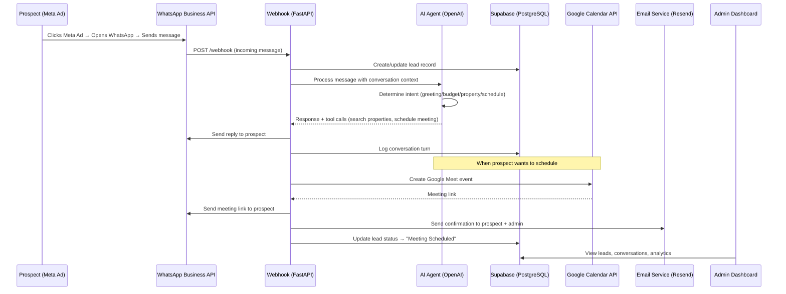

# LeadGen — Lead Generation & AI Automation System

A Dubai-based real estate lead generation platform powered by WhatsApp Business API, AI conversational agents, and automated meeting scheduling.

## Business Flow



---

## User Review Required

> [!IMPORTANT]
> **LLM Provider** — Plan assumes OpenAI (`gpt-4o` / `gpt-4o-mini`). Confirm or specify alternative (Gemini, Claude, etc.).

> [!IMPORTANT]
> **Email Service** — Plan uses [Resend](https://resend.com) for transactional emails. Alternatives: SendGrid, AWS SES. Confirm preference.

> [!IMPORTANT]
> **Google Workspace** — Google Calendar API with service accounts requires a Google Workspace domain for domain-wide delegation. Confirm you have this, or we'll use OAuth2 flow instead.

> [!WARNING]
> **WhatsApp Business API** — You need a Meta Business account with WhatsApp Business Platform enabled, a verified phone number, and approved message templates. This is a prerequisite before Phase 5 can be tested end-to-end.

## Open Questions

1. **Company name for branding?** — Currently using "LeadGen" as a placeholder. What's the customer-facing brand name for the Dubai real estate company?
2. **Property data source?** — Do you have an existing property database/API, or should we seed with sample Dubai properties in Supabase?
3. **Admin auth** — Should admin login use Supabase Auth (email/password) or a third-party SSO?
4. **Multi-agent or single agent?** — One AI agent handling the full conversation, or specialized agents (qualifier → property matcher → scheduler)?
5. **Deployment target?** — Railway, Fly.io, VPS, or other? This affects the Dockerfile and CI/CD setup in Phase 8.

---

## Phase 1 — Project Scaffolding & Configuration

### Goal
Set up both frontend and backend with proper directory structures, linting, formatting, environment configs, and git hygiene.

---

### Backend

#### [NEW] [pyproject.toml](backend/pyproject.toml)
UV project config with all dependencies:
- **Web**: `fastapi`, `uvicorn[standard]`, `python-multipart`
- **Database**: `supabase`, `httpx`
- **AI**: `openai`
- **Integrations**: `google-api-python-client`, `google-auth`
- **Email**: `resend`
- **Utils**: `pydantic-settings`, `python-dotenv`, `structlog`
- **Dev**: `pytest`, `pytest-asyncio`, `ruff`, `mypy`

#### [NEW] Backend directory structure
```
backend/
├── pyproject.toml
├── .env.example
├── src/
│   ├── __init__.py
│   ├── main.py                    # FastAPI app factory
│   ├── core/
│   │   ├── __init__.py
│   │   ├── config.py              # pydantic-settings based config
│   │   ├── database.py            # Supabase client singleton
│   │   ├── security.py            # Webhook signature verification, JWT
│   │   ├── exceptions.py          # Custom exception classes
│   │   └── logging.py             # structlog configuration
│   ├── modules/
│   │   ├── __init__.py
│   │   ├── webhooks/
│   │   │   ├── __init__.py
│   │   │   ├── router.py          # GET verify + POST receive
│   │   │   ├── schemas.py         # WhatsApp payload Pydantic models
│   │   │   └── service.py         # Signature verification, message extraction
│   │   ├── leads/
│   │   │   ├── __init__.py
│   │   │   ├── router.py          # CRUD endpoints for admin
│   │   │   ├── schemas.py         # Lead DTOs
│   │   │   ├── service.py         # Lead business logic
│   │   │   └── repository.py      # Supabase queries
│   │   ├── conversations/
│   │   │   ├── __init__.py
│   │   │   ├── router.py          # Conversation history endpoints
│   │   │   ├── schemas.py
│   │   │   ├── service.py
│   │   │   └── repository.py
│   │   ├── agent/
│   │   │   ├── __init__.py
│   │   │   ├── orchestrator.py     # Main conversation loop
│   │   │   ├── prompts.py          # System prompts & templates
│   │   │   ├── tools.py            # Function definitions for OpenAI
│   │   │   └── property_search.py  # Property matching logic
│   │   ├── properties/
│   │   │   ├── __init__.py
│   │   │   ├── router.py
│   │   │   ├── schemas.py
│   │   │   ├── service.py
│   │   │   └── repository.py
│   │   ├── meetings/
│   │   │   ├── __init__.py
│   │   │   ├── router.py
│   │   │   ├── schemas.py
│   │   │   ├── service.py         # Google Calendar integration
│   │   │   └── repository.py
│   │   ├── notifications/
│   │   │   ├── __init__.py
│   │   │   ├── whatsapp.py        # WhatsApp message sender
│   │   │   └── email.py           # Resend email sender
│   │   ├── analytics/
│   │   │   ├── __init__.py
│   │   │   ├── router.py
│   │   │   ├── schemas.py
│   │   │   └── service.py
│   │   └── auth/
│   │       ├── __init__.py
│   │       ├── router.py          # Admin login/logout
│   │       ├── schemas.py
│   │       ├── service.py
│   │       └── middleware.py       # Auth middleware
│   └── utils/
│       ├── __init__.py
│       └── helpers.py
└── tests/
    ├── __init__.py
    ├── conftest.py
    └── modules/                    # Mirrors src/modules structure
```

---

### Frontend

#### [MODIFY] [package.json](frontend/package.json)
Add dependencies:
- `react-router-dom`, `react-hook-form`, `@hookform/resolvers`, `zod`, `zustand`
- `@tanstack/react-query`, `axios`, `date-fns`, `recharts`, `lucide-react`
- `sonner` (toast notifications), `clsx`, `tailwind-merge`

#### [NEW] Frontend directory structure
```
frontend/src/
├── assets/                  # Static images, icons
├── components/
│   ├── ui/                  # shadcn/ui components (auto-generated)
│   ├── layout/
│   │   ├── AppShell.tsx     # Sidebar + Header + Main wrapper
│   │   ├── Sidebar.tsx
│   │   ├── Header.tsx
│   │   └── MobileNav.tsx
│   ├── shared/
│   │   ├── DataTable.tsx    # Reusable table with sorting/filtering
│   │   ├── StatCard.tsx     # Dashboard metric cards
│   │   ├── StatusBadge.tsx  # Lead status badges
│   │   ├── EmptyState.tsx
│   │   └── LoadingState.tsx
│   └── forms/
│       ├── PropertyForm.tsx
│       ├── LeadForm.tsx
│       └── MeetingForm.tsx
├── pages/
│   ├── Dashboard.tsx
│   ├── Leads.tsx
│   ├── LeadDetail.tsx
│   ├── Properties.tsx
│   ├── PropertyDetail.tsx
│   ├── Conversations.tsx
│   ├── ConversationView.tsx
│   ├── Meetings.tsx
│   ├── Analytics.tsx
│   ├── Settings.tsx
│   └── Login.tsx
├── hooks/
│   ├── useLeads.ts
│   ├── useProperties.ts
│   ├── useConversations.ts
│   ├── useMeetings.ts
│   └── useAnalytics.ts
├── stores/
│   ├── authStore.ts
│   ├── sidebarStore.ts
│   └── filterStore.ts
├── services/
│   ├── api.ts               # Axios instance + interceptors
│   ├── leadService.ts
│   ├── propertyService.ts
│   ├── conversationService.ts
│   ├── meetingService.ts
│   └── analyticsService.ts
├── lib/
│   ├── utils.ts              # cn() helper, formatters
│   ├── validators.ts         # Zod schemas
│   └── constants.ts
├── types/
│   └── index.ts              # TypeScript interfaces
├── App.tsx
├── main.tsx
└── index.css
```

---

### Root Config

#### [MODIFY] [.gitignore](.gitignore)
Add standard ignores: `node_modules/`, `.venv/`, `.env`, `__pycache__/`, `dist/`, `.DS_Store`

#### [NEW] [README.md](README.md)
Project overview, setup instructions, architecture diagram.

---

## Phase 2 — Frontend Theming & Design System

### Goal
Set up Tailwind CSS v4, shadcn/ui, dark/light mode toggle, and the blue-themed design system.

#### [MODIFY] [vite.config.ts](frontend/vite.config.ts)
- Add `@tailwindcss/vite` plugin
- Add `@` path alias → `./src`

#### [NEW] [src/index.css](frontend/src/index.css)
- `@import "tailwindcss"`
- CSS custom properties for shadcn theming (blue palette):
  - **Light**: Primary `hsl(221, 83%, 53%)` (vibrant blue), background white, muted slate tones
  - **Dark**: Primary `hsl(217, 91%, 60%)`, background `hsl(222, 47%, 11%)` (deep navy), card surfaces with subtle blue tint
- Google Font import: `Inter` for body, `Plus Jakarta Sans` for headings
- Smooth transitions on theme switch

#### [NEW] [src/components/ThemeProvider.tsx](frontend/src/components/ThemeProvider.tsx)
- React context for `light | dark | system` theme
- Persists to localStorage
- Applies class to `<html>` element

#### [NEW] [src/components/ThemeToggle.tsx](frontend/src/components/ThemeToggle.tsx)
- Animated sun/moon toggle button using shadcn DropdownMenu

#### Run `npx shadcn@latest init` and add base components:
`button`, `input`, `card`, `dialog`, `dropdown-menu`, `table`, `badge`, `tabs`, `avatar`, `separator`, `sheet`, `select`, `textarea`, `tooltip`, `popover`, `calendar`, `command`

---

## Phase 3 — Frontend UI Components & Pages

### Goal
Build all admin dashboard pages with mock data. No backend integration yet — pure UI.

---

### 3A — Layout Shell

#### [NEW] `AppShell.tsx`
- Collapsible sidebar (desktop) / bottom sheet (mobile)
- Top header with search, notifications bell, theme toggle, user avatar
- Breadcrumb navigation
- Smooth sidebar collapse animation

#### [NEW] `Sidebar.tsx`
- Navigation links with icons (lucide-react): Dashboard, Leads, Properties, Conversations, Meetings, Analytics, Settings
- Active state highlighting with blue accent
- Collapse to icon-only mode
- Company logo at top

---

### 3B — Dashboard Page

#### [NEW] `Dashboard.tsx`
- **Stat cards row**: Total Leads, Active Conversations, Meetings This Week, Conversion Rate
  - Each card: icon, value, label, trend indicator (↑↓ with green/red)
  - Subtle gradient backgrounds, hover lift animation
- **Charts section** (recharts):
  - Lead acquisition over time (area chart)
  - Lead source breakdown (donut chart)
  - Conversion funnel (bar chart)
- **Recent activity feed**: Latest lead interactions in a timeline
- **Upcoming meetings**: Next 5 meetings in card format

---

### 3C — Leads Page

#### [NEW] `Leads.tsx`
- DataTable with columns: Name, Phone, Status, Source, Budget, Last Contact, Actions
- Status badges: `New` (blue), `Contacted` (yellow), `Qualified` (green), `Meeting Scheduled` (purple), `Converted` (emerald), `Lost` (red)
- Filters: status, date range, budget range, source
- Search bar with debounced input
- Bulk actions (change status, export CSV)
- "Add Lead" button → dialog with RHF + Zod form

#### [NEW] `LeadDetail.tsx`
- Left panel: Lead info card (name, phone, email, budget, preferences, status timeline)
- Right panel: Conversation history (WhatsApp-style chat bubbles)
- Actions: Change status, Schedule meeting, Add note, Edit info

---

### 3D — Properties Page

#### [NEW] `Properties.tsx`
- Grid/List toggle view
- Property cards: image, title, location, price, bedrooms, area, status
- Filters: type (apartment/villa/townhouse), price range, bedrooms, area
- Add/Edit property dialog

#### [NEW] `PropertyDetail.tsx`
- Image gallery, full details, map placeholder
- Matched leads section

---

### 3E — Conversations Page

#### [NEW] `Conversations.tsx`
- WhatsApp-inspired layout: conversation list on left, chat view on right
- Each conversation: lead name, last message preview, timestamp, unread count
- Chat view: message bubbles (user = right/green, agent = left/blue), timestamps
- Read-only view for admin monitoring

---

### 3F — Meetings Page

#### [NEW] `Meetings.tsx`
- Calendar view (month/week/day) + list view toggle
- Meeting cards: lead name, date/time, Google Meet link, status
- Filters: upcoming/past, status

---

### 3G — Analytics Page

#### [NEW] `Analytics.tsx`
- Date range picker
- KPI cards: Total leads, Qualified rate, Avg response time, Meeting conversion
- Charts: Lead pipeline over time, Response time distribution, Agent performance
- Export to CSV button

---

### 3H — Settings & Auth Pages

#### [NEW] `Settings.tsx`
- Tabs: General, WhatsApp Config, AI Agent, Notifications, Team
- Form sections with RHF + Zod validation

#### [NEW] `Login.tsx`
- Clean login form: email + password
- Company logo, gradient background
- "Forgot password" link

---

## Phase 4 — Backend Core & Database

### Goal
Set up FastAPI application, Supabase schema, and core modules (auth, leads, properties, conversations).

---

### 4A — Supabase Database Schema

```sql
-- Leads table
CREATE TABLE leads (
  id UUID PRIMARY KEY DEFAULT gen_random_uuid(),
  phone VARCHAR(20) UNIQUE NOT NULL,
  name VARCHAR(255),
  email VARCHAR(255),
  whatsapp_id VARCHAR(50),
  status VARCHAR(30) DEFAULT 'new',
  source VARCHAR(50) DEFAULT 'whatsapp',
  budget_min DECIMAL(15,2),
  budget_max DECIMAL(15,2),
  preferred_type VARCHAR(50),          -- apartment/villa/townhouse
  preferred_location TEXT,
  preferred_bedrooms INTEGER,
  notes TEXT,
  metadata JSONB DEFAULT '{}',
  created_at TIMESTAMPTZ DEFAULT NOW(),
  updated_at TIMESTAMPTZ DEFAULT NOW()
);

-- Properties table
CREATE TABLE properties (
  id UUID PRIMARY KEY DEFAULT gen_random_uuid(),
  title VARCHAR(255) NOT NULL,
  description TEXT,
  type VARCHAR(50) NOT NULL,
  location VARCHAR(255) NOT NULL,
  area VARCHAR(100),
  price DECIMAL(15,2) NOT NULL,
  bedrooms INTEGER,
  bathrooms INTEGER,
  area_sqft DECIMAL(10,2),
  amenities TEXT[],
  images TEXT[],
  status VARCHAR(30) DEFAULT 'available',
  featured BOOLEAN DEFAULT FALSE,
  metadata JSONB DEFAULT '{}',
  created_at TIMESTAMPTZ DEFAULT NOW(),
  updated_at TIMESTAMPTZ DEFAULT NOW()
);

-- Conversations table
CREATE TABLE conversations (
  id UUID PRIMARY KEY DEFAULT gen_random_uuid(),
  lead_id UUID REFERENCES leads(id) ON DELETE CASCADE,
  status VARCHAR(30) DEFAULT 'active',
  started_at TIMESTAMPTZ DEFAULT NOW(),
  ended_at TIMESTAMPTZ,
  summary TEXT,
  metadata JSONB DEFAULT '{}'
);

-- Messages table
CREATE TABLE messages (
  id UUID PRIMARY KEY DEFAULT gen_random_uuid(),
  conversation_id UUID REFERENCES conversations(id) ON DELETE CASCADE,
  role VARCHAR(20) NOT NULL,          -- 'user', 'assistant', 'system'
  content TEXT NOT NULL,
  whatsapp_message_id VARCHAR(100),
  metadata JSONB DEFAULT '{}',
  created_at TIMESTAMPTZ DEFAULT NOW()
);

-- Meetings table
CREATE TABLE meetings (
  id UUID PRIMARY KEY DEFAULT gen_random_uuid(),
  lead_id UUID REFERENCES leads(id) ON DELETE CASCADE,
  conversation_id UUID REFERENCES conversations(id),
  title VARCHAR(255),
  scheduled_at TIMESTAMPTZ NOT NULL,
  duration_minutes INTEGER DEFAULT 30,
  google_meet_link TEXT,
  google_event_id VARCHAR(255),
  status VARCHAR(30) DEFAULT 'scheduled',
  notes TEXT,
  created_at TIMESTAMPTZ DEFAULT NOW()
);

-- Admin users table
CREATE TABLE admin_users (
  id UUID PRIMARY KEY DEFAULT gen_random_uuid(),
  email VARCHAR(255) UNIQUE NOT NULL,
  name VARCHAR(255),
  role VARCHAR(30) DEFAULT 'agent',
  created_at TIMESTAMPTZ DEFAULT NOW()
);

-- Lead status history
CREATE TABLE lead_status_history (
  id UUID PRIMARY KEY DEFAULT gen_random_uuid(),
  lead_id UUID REFERENCES leads(id) ON DELETE CASCADE,
  from_status VARCHAR(30),
  to_status VARCHAR(30) NOT NULL,
  changed_by UUID REFERENCES admin_users(id),
  changed_at TIMESTAMPTZ DEFAULT NOW()
);

-- RLS policies and indexes omitted for brevity — will be implemented
```

---

### 4B — FastAPI Core

#### [NEW] `src/main.py`
- FastAPI app factory with CORS, exception handlers, router registration
- Health check endpoint `/health`
- API versioning under `/api/v1/`

#### [NEW] `src/core/config.py`
- `pydantic-settings` based `Settings` class
- Env vars: `SUPABASE_URL`, `SUPABASE_KEY`, `OPENAI_API_KEY`, `WHATSAPP_TOKEN`, `WHATSAPP_PHONE_ID`, `WHATSAPP_VERIFY_TOKEN`, `WHATSAPP_APP_SECRET`, `GOOGLE_SERVICE_ACCOUNT_JSON`, `RESEND_API_KEY`

#### [NEW] `src/core/database.py`
- Supabase client singleton using `supabase-py`

#### [NEW] `src/core/security.py`
- WhatsApp webhook signature verification (`X-Hub-Signature-256`)
- JWT token validation for admin endpoints

#### [NEW] `src/core/logging.py`
- `structlog` JSON logging setup

---

### 4C — CRUD Modules

For each module (leads, properties, conversations, meetings, auth):
- **router.py**: RESTful endpoints (`GET /`, `GET /{id}`, `POST /`, `PATCH /{id}`, `DELETE /{id}`)
- **schemas.py**: Pydantic request/response models with Zod-equivalent validation
- **service.py**: Business logic layer
- **repository.py**: Supabase query layer

---

## Phase 5 — WhatsApp Integration & AI Agent

### Goal
Implement the WhatsApp webhook, AI conversational agent, and the full message processing pipeline.

---

### 5A — Webhook Module

#### [NEW] `src/modules/webhooks/router.py`
- `GET /webhook` — Meta verification handshake
- `POST /webhook` — Receive incoming messages
  - Verify `X-Hub-Signature-256`
  - Extract message content (text, interactive replies)
  - Return `200 OK` immediately
  - Process message asynchronously via background task

#### [NEW] `src/modules/webhooks/service.py`
- Parse WhatsApp payload → extract sender phone, message text, message type
- Upsert lead by phone number
- Get or create conversation
- Pass to agent orchestrator
- Send response back via WhatsApp API

---

### 5B — AI Agent

#### [NEW] `src/modules/agent/orchestrator.py`
- Load conversation history from DB
- Build messages array with system prompt + history + new message
- Call OpenAI Chat Completions API with function/tool definitions
- Handle tool calls in a loop:
  - `search_properties(type, budget_min, budget_max, bedrooms, location)` → query Supabase
  - `update_lead_info(name, email, budget, preferences)` → update lead record
  - `schedule_meeting(date, time)` → create Google Meet + send confirmations
  - `get_available_slots(date)` → check Google Calendar availability
- Save assistant response to DB
- Return response text

#### [NEW] `src/modules/agent/prompts.py`
- System prompt: Dubai real estate agent persona
  - Professional, warm, knowledgeable about Dubai areas
  - Conversation flow: Greet → Qualify (budget, type, location) → Show properties → Schedule meeting
  - Instructions for each stage
  - Formatting guidelines for WhatsApp (no markdown, use emojis sparingly)

#### [NEW] `src/modules/agent/tools.py`
- OpenAI function definitions as Python dicts
- Each function: name, description, parameters (JSON Schema)

#### [NEW] `src/modules/agent/property_search.py`
- Build Supabase query from agent parameters
- Format property results for WhatsApp display
- Handle no-results gracefully

---

### 5C — Notification Module

#### [NEW] `src/modules/notifications/whatsapp.py`
- `send_text_message(phone, text)` — Send plain text via WhatsApp Cloud API
- `send_template_message(phone, template_name, params)` — Send approved templates
- `send_interactive_message(phone, body, buttons)` — Send button messages
- Uses `httpx.AsyncClient` for all API calls

#### [NEW] `src/modules/notifications/email.py`
- `send_meeting_confirmation(lead_email, meeting_details)` — To prospect
- `send_admin_notification(admin_email, lead_info, meeting_details)` — To admin
- Uses Resend SDK

---

## Phase 6 — Google Meet Integration

### Goal
Integrate Google Calendar API to create meetings and check availability.

#### [NEW] `src/modules/meetings/service.py`
- `create_meeting(lead_id, scheduled_at, duration)`:
  1. Create Google Calendar event with Google Meet conference
  2. Save meeting record to Supabase
  3. Send WhatsApp message with meet link to prospect
  4. Send email confirmation to prospect + admin
  5. Update lead status to "meeting_scheduled"
- `get_available_slots(date)`: Query Google Calendar freebusy API
- `cancel_meeting(meeting_id)`: Cancel event + notify

---

## Phase 7 — Frontend-Backend Integration

### Goal
Connect all frontend pages to real backend APIs, implement real-time features.

#### [NEW] `src/services/api.ts`
- Axios instance with base URL, auth interceptor, error handling
- Request/response interceptors for token refresh

#### [MODIFY] All pages
- Replace mock data with `@tanstack/react-query` hooks
- Connect forms to API via mutation hooks
- Add optimistic updates for status changes
- Real-time conversation updates via Supabase Realtime subscription

#### [MODIFY] Zustand stores
- `authStore`: Login/logout, token management, user state
- `filterStore`: Persist filter state across navigation

---

## Phase 8 — Production Hardening

### Goal
Security, performance, testing, deployment preparation.

### Backend
- Rate limiting on webhook endpoint (`slowapi`)
- Request validation and sanitization
- Comprehensive error handling with proper HTTP status codes
- API documentation (auto-generated OpenAPI/Swagger)
- Unit tests for services, integration tests for API endpoints
- Dockerfile + docker-compose for local development

### Frontend
- Error boundaries on all pages
- Skeleton loading states
- SEO meta tags
- PWA manifest for mobile admin access
- Bundle optimization (code splitting, lazy routes)
- E2E smoke tests

### DevOps
- `.env.example` files for both frontend and backend
- GitHub Actions CI pipeline (lint, test, build)
- Deployment configs (Railway/Fly.io Procfile or Dockerfile)

---

## Verification Plan

### Automated Tests
```bash
# Backend
cd backend && uv run pytest tests/ -v --cov=src

# Frontend
cd frontend && npm run lint && npm run build

# Type checking
cd frontend && npx tsc --noEmit
```

### Manual Verification
- **Phase 2**: Visual inspection of light/dark theme, responsive layout
- **Phase 3**: Navigate all pages, verify interactions with mock data
- **Phase 5**: Send test WhatsApp message → verify webhook receives → AI responds → DB updated
- **Phase 6**: Trigger meeting scheduling → verify Google Meet link created → emails sent
- **Phase 7**: Full end-to-end flow from Meta ad click to meeting scheduled

### Browser Testing
- Dashboard renders with charts and stats
- Lead table sorting, filtering, pagination works
- Conversation view displays messages correctly
- Dark/light mode toggle works across all pages
- Mobile responsive layout works

---

## Phase Execution Order

| Phase | Name | Depends On | Est. Effort |
|-------|------|-----------|-------------|
| 1 | Project Scaffolding | — | 1 session |
| 2 | Frontend Theming | Phase 1 | 1 session |
| 3 | UI Components & Pages | Phase 2 | 3-4 sessions |
| 4 | Backend Core & DB | Phase 1 | 2 sessions |
| 5 | WhatsApp & AI Agent | Phase 4 | 2-3 sessions |
| 6 | Google Meet Integration | Phase 5 | 1 session |
| 7 | Frontend-Backend Integration | Phase 3 + 6 | 2 sessions |
| 8 | Production Hardening | Phase 7 | 1-2 sessions |
